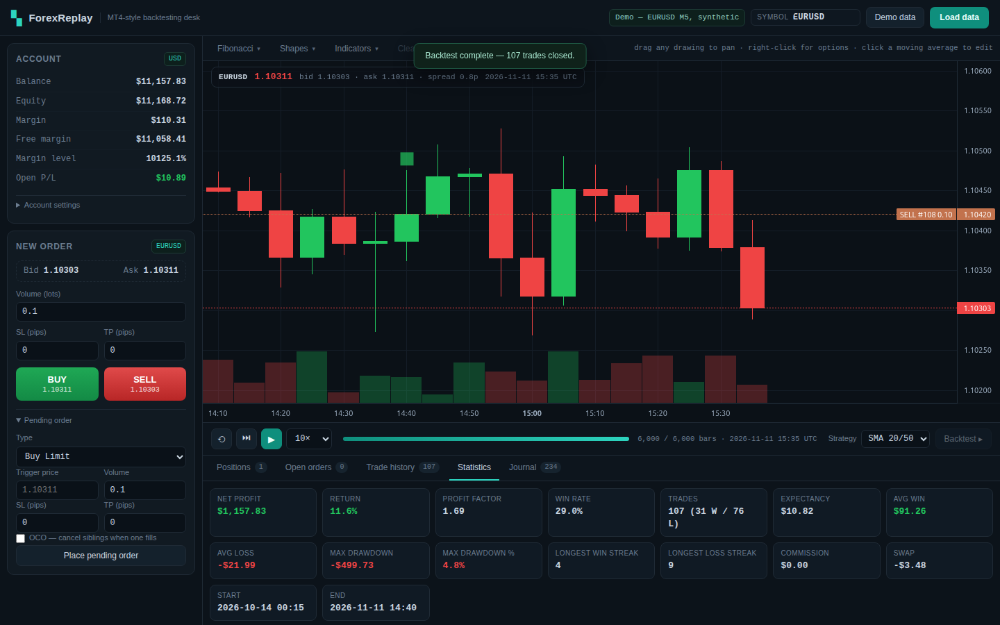
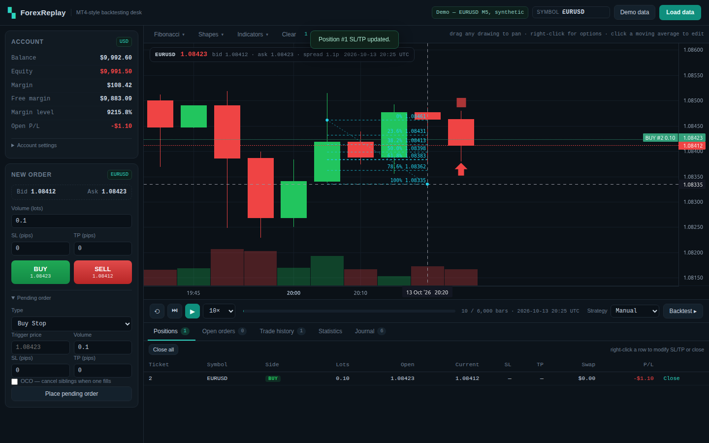
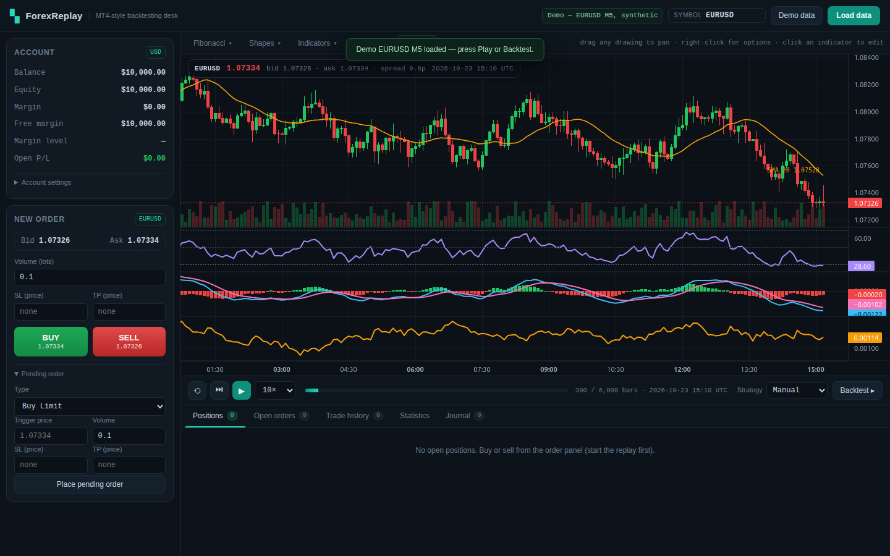

# Forex Replay — MT4-style backtesting desk (browser, open source)

[](LICENSE)
[](CONTRIBUTING.md)

A free, self-hosted backtesting workspace that behaves like the MT4 **Strategy Tester in
visual mode**: load historical data, press play, and trade against a real *account* —
balance, equity, margin, free margin, stop-out, swap, commission, pending orders and a
full trade statement. Everything runs in your browser; your data never leaves the machine.

> **Live demo:** <https://Nanthasubbiah.github.io/forex-replay/> — no install needed.
>
> Not affiliated with MetaQuotes. It re-implements MT4 *account semantics*, not MQL4/`.ex4`.



| Fibonacci & drawing tools | Indicators & oscillator pane |
|---|---|
|  |  |

---

## Why this exists

The paid market already sells "MT4 backtesters" (Forex Tester, FX Blue, TradingView replay).
What was missing from open source was the *experience*: a free, local, browser-based desk
where you upload broker-grade history and trade/backtest under MT4 account rules.

**Data**: this project is built around free downloads from
[EV Trading Labs](https://evtradelabs.com/data) — 19 symbols (FX majors, XAU/XAG, indices,
crypto, oil), M1→D1, 2003–2026, aggregated from Dukascopy **ticks with bid *and* ask**
prices. M5+ is free; M1 and the current year need a free account on their site.
**Do not redistribute their files** — download them yourself and load them into the app.

---

## Features (Phase 1)

### MT4 account model
| Feature | Status |
|---|---|
| Balance / Equity / Margin / Free margin / Margin level | ✅ |
| Lot sizing with per-symbol contract size & pip value | ✅ |
| Market orders (fill at ask for buys, bid for sells) | ✅ |
| Pending: Buy Limit / Sell Limit / Buy Stop / Sell Stop | ✅ |
| SL / TP (intrabar, gap-aware, conservative SL-first) | ✅ |
| Swap per lot per night, triple swap on Wednesday | ✅ |
| Commission per lot per side | ✅ |
| Stop-out when margin level < X% (worst position first) | ✅ |
| Trade history → statement-style report | ✅ |
| Slippage (configurable, pips) | ✅ |

### Trading desk
- Pending orders are drawn on the chart as dashed lines labelled `BUY STOP #12` etc.;
  when triggered they are replaced by the `BUY #12 0.10` position line (same for sells).
  A pending order that carries SL/TP also draws those two levels on the chart.
- The order panel takes **SL/TP as prices**, not pips — both for market orders and pending
  orders (leave a field empty for none; the engine validates the side of the entry).
- **Drag an SL or TP line** on the chart to move it — for open positions *and* for pending
  orders. The line sticks to the valid side of the entry/trigger price while you drag and is
  committed (with the usual toast/validation) when you release the mouse.
- Hovering any bar shows its **date, time, OHLC and volume** in a strip at the bottom of the
  chart (`▲`/`▼` colouring on the close), so you can inspect a candle without leaving the chart.
- Right-click any row in *Positions* to **modify SL/TP** or **close**, and in *Open orders*
  to **modify** (trigger price / SL / TP) or **cancel**. All validation is done by the engine
  and errors appear as toasts.
- **Fibonacci drawing tools** live in the top chart toolbar: the `Fibonacci ▾` tab opens a
  dropdown with **Retracement** (0–100% between two swing points) and **Extension**
  (retracement plus auto-drawn 127.2% and 161.8% projections). After choosing a tool, click
  the swing start and end on the chart. Each drawing renders:
  - a dotted diagonal between the two clicked points with anchor handles,
  - horizontal level segments **that span only between those two points** (not the whole
    chart), labelled with ratio and price (61.8% highlighted).

  Interaction:
  - **Drag the diagonal** (or any level line) to move the whole tool;
  - **drag an anchor handle** to resize / re-aim the swing;
  - **right-click a level line** to instantly hide/show that single level; **right-click the
    diagonal or anchors** for the full editor: show/hide, remove and add levels (custom %s),
    colour picker + palette, and remove the tool;
  - `Esc` cancels a drawing in progress; `Clear` (toolbar) removes all drawings.

- **Line tools** live in the `Shapes ▾` toolbar tab:
  - **Vertical line** and **Horizontal line** — one click to place them on the chart;
  - **Trend line** — two clicks to connect two points; past the second point it is projected as
    a dashed continuation all the way to the right edge of the chart window (the projection is
    grabbable, so dragging it pans the line like the rest of it).
  Every line can be dragged to pan it (dragging a trend-line endpoint re-aims it). Right-click
  a line to change its colour or remove it; `Clear` removes all Fibonacci and line drawings.

- **Crosshair ruler** (MT4-style): the `Crosshair` toolbar button arms a measuring crosshair.
  Click one point, then a second: the chart draws the span and an on-chart label that reads the
  **bar count**, the **elapsed time** and the price distance in **pips and points** (derived
  from the symbol's pip size and digits, so it is correct for FX, JPY pairs, metals, indices
  and crypto). Moving the pointer previews the numbers before the second click is committed.
  Click again to start a new measurement; `Esc` clears the ruler (a second `Esc` leaves the
  crosshair mode).

- **Indicators** live in the `Indicators ▾` tab. Every indicator is defined once in a
  small registry (`src/lib/indicatorRegistry.ts`) as `compute(bars, count, params) → buffers`
  plus rendering metadata, so the menu, the settings editor and the chart renderer are shared:

  | Indicator | Placement | Outputs |
  | --- | --- | --- |
  | Moving average (SMA / EMA) | price pane | line (+ direction colours, + pip bounds) |
  | Bollinger Bands | price pane | basis + upper / lower bands |
  | RSI (Wilder) | own pane | line with 30 / 50 / 70 guides |
  | MACD | own pane | MACD + signal lines, coloured histogram |
  | ATR (Wilder) | own pane | line |

  - **Price-pane** indicators draw on the chart canvas and can be clicked to edit their settings.
  - **Oscillators** get their own pane below the price chart; open them from the Indicators menu
    to change parameters or colours.
  - **Moving average extras**: *Colour by direction* (rising / falling segments get their own
    colours) and *Bounds* (dashed lines shifted by the pip distance you enter).
  - Values are recomputed as the replay advances and never use future bars; the replay reset
    rewinds every series. Replay renames/resets keep the configured indicators.

### Replay & analysis
- Bar-by-bar replay with play/pause/step, 1×–400× speed, progress + UTC timestamp.
- Candlestick chart (lightweight-charts), volume histogram (toggle with the `Volumes`
  toolbar button), trade markers, live SL/TP/entry lines.
- Statistics: net profit, return %, profit factor, win rate, expectancy, avg win/loss,
  max drawdown (abs & %), streaks, commission, swap, monthly P/L table.
- Journal of every fill, pending trigger, swap charge and stop-out.

### Strategy API (TypeScript, runs in-browser)
```ts
import type { Strategy, StrategyContext } from "./strategy/api";

export class MyEdge implements Strategy {
  name = "My edge";
  description = "Example";
  onBar(ctx: StrategyContext) {
    if (ctx.history.sma(20)! > ctx.history.sma(50)!) {
      if (!ctx.positions.some((p) => p.side === "buy")) {
        ctx.buy(0.1, { sl: ctx.bar.bid.c - 0.002, tp: ctx.bar.bid.c + 0.004 });
      }
    }
  }
}
```
Market orders placed from a strategy fill on the **next bar's open**, which makes
look-ahead bias structurally impossible. Two built-in runs: `Manual` or `SMA 20/50`
(press **Backtest ▸** to run it to completion).

---

## Quick start

```bash
npm install
npm run dev        # http://localhost:5173 (port may vary)
```

1. **Demo data** → loads a synthetic M5 year (6,000 bars) instantly — for whichever symbol is in the
   **Symbol** box (EURUSD by default).
2. or **Load data** → pick your downloaded `SYMBOL_TF_YEAR.json.gz` (or a CSV export).
3. Press ▶ Play / ⏭ Step, then trade from the order panel.
4. See the *Statistics* tab for the statement.

### Choosing the symbol
The **Symbol** box in the top bar is editable, so the replay is not tied to EURUSD:

- type any code (`GBPUSD`, `USDJPY`, `XAUUSD`, …) and press **Enter** (or blur the box);
  the built-in catalogue autocompletes as you type;
- **before loading** it decides the symbol the next load uses — useful when the file name carries
  no symbol (`2026.json.gz`), which would otherwise keep the previous one;
- **after loading** it re-labels the bars in place: the simulator is rebuilt with that symbol's
  contract spec (pip size, contract size, digits), so pips, margin, pip value and the price axis
  all follow, and the replay restarts from bar 1 (drawings and indicators are kept);
- broker suffixes work too: `GBPUSD.a`, `XAUUSDm`, `EURUSD-raw` reuse the plain contract spec but
  keep your broker's spelling on screen. Unknown codes fall back to a generic 5-digit, 100k FX
  contract (6-letter pairs get their base/quote split automatically).
- `Esc` reverts the box to the symbol in use; junk input is refused with a toast.

### Supported data files
| Format | Notes |
|---|---|
| evtradelabs `.json.gz` | The normal download. Contains `ts` + bid `o,h,l,c` + ask `ao,ah,al,ac` + `v`. **Preferred.** |
| JSON array | Same schema, plain `.json`. |
| CSV | Header aliases: `time/date/timestamp`, `open/high/low/close`, optional `ao/ah/al/ac`, `volume`. Also parses MT4's `Date;Time;Open…` exports (dates read as UTC). |
| Bid-only files | Set *"Bid-only spread (pips)"* in Account settings; the spread is synthesised. |
| ZIP | Not yet supported — unzip first. |

Symbol is inferred from the filename (`AUDUSD_M5_2025.json.gz` → `AUDUSD`), otherwise EURUSD.

---

## Simulation semantics (read this before trusting a number)

- **Bar-level simulation** (like MT4's "M1 OHLC" mode). No tick-level modelling yet.
- Prices come from the file's own bid/ask; spreads and gaps are real, not cosmetic.
- Buys execute at ask, sells at bid; profitable exits are the mirror.
- If a bar's high and low could have hit both SL and TP, **SL is assumed to hit first**
  (worst case for the trader). Gaps fill at the bar's open, never better than requested.
- Margin: `lots × contractSize × price / leverage` in USD, with quote→USD conversion for
  JPY/GBP/EUR-quoted instruments. The conversion table is editable per-session in the
  simulator config when a needed pair isn't loaded (Phase 2 adds multi-symbol books).
- Stop-out closes the largest-losing positions first until margin level ≥ threshold.
- Swap is applied per UTC day rollover; Wednesday is triple. Defaults per symbol are
  placeholders — tune them for your broker.
- Strategy orders are next-bar-open; manual orders fill at the current (last processed)
  bar's close, mirroring MT4 instant execution.

---

## Architecture

```
src/
  engine/      pure, framework-free simulation core (unit-tested)
    symbols.ts   contract specs for all 19 evtradelabs symbols
    account.ts   pip value, margin, conversion, P/L
    simulator.ts order lifecycle, SL/TP, stop-out, swap, strategy hooks
    stats.ts     statement statistics + monthly buckets
  data/        evtradelabs JSON.gz / CSV parsers (gzip via DecompressionStream) + demo
  strategy/    Strategy API types + built-in SMA cross
  lib/         pure chart helpers: Fibonacci geometry, moving-average math/cache, line shapes, crosshair ruler math
  ui/          React terminal: chart, canvas overlay, editors, account, order panel, replay, tabs
  store.ts     zustand orchestration (replay clock, settings, toasts, drawings, indicators)
  indicatorRegistry.ts  indicator API: params, colours, outputs, compute functions (MA, RSI, MACD, ATR, Bollinger)
tests/         vitest: account math, fills, pendings, stop-out, swap, stats, parsers, indicators, ruler math
scripts/       headless Chrome smoke tests (playwright-core, system chrome — no download)
```

### Verify it
```bash
npm test              # 104 engine/parser/indicator/symbol/shape/ruler tests (vitest)
npm run typecheck     # tsc --noEmit
npm run build         # tsc --noEmit + vite build

# browser smoke tests (needs a dev server on 5199 and a local Chrome; set
# CHROME_PATH if yours is not /usr/bin/google-chrome):
npx vite --port 5199 --strictPort &
CHROME_PATH=/usr/bin/google-chrome node scripts/smoke.mjs   # demo data, play, trade, strategy backtest
node scripts/smoke-realdata.mjs     # a real evtradelabs file through the UI parser
node scripts/smoke-actions.mjs      # pending lines, right-click modify/close, Fibonacci tool
node scripts/smoke-shapes-ma.mjs    # line tools, MA settings, click-to-edit
node scripts/verify-indicators.mjs  # RSI / MACD / ATR panes + MA overlay, replay reset
node scripts/verify-trend-ray.mjs   # trend-line projection to the right edge + drag
node scripts/smoke-symbol.mjs       # editable Symbol box: re-label, junk input, file fallback
```

---

## Deploying

The app is a static bundle with no backend and no data bundled into it, so it hosts anywhere.

**GitHub Pages (what the demo uses).** Enable *Settings → Pages → Source: **GitHub Actions***,
then push to the default branch — `.github/workflows/pages.yml` builds and publishes `dist/`.
The build uses relative asset URLs, so it works under `https://<user>.github.io/<repo>/`
without configuring a `base` path.

**Anywhere else** — build and serve the folder:

```bash
npm run build
# then serve dist/ (nginx, Netlify, S3, `npm run preview`, …)
```

Each visitor parses their own history file locally in the browser; nothing is uploaded to
a server, so a static host costs nothing and needs no privacy policy.

## Contributing

Issues and PRs are welcome — see [CONTRIBUTING.md](CONTRIBUTING.md). The short version:

```bash
npm run typecheck && npm test && npm run build
```

CI runs that on Node 20 and 22 for every PR. The engine (`src/engine/`) and the chart math
(`src/lib/`) are deliberately framework-free and unit-tested, and individual indicators,
symbols and drawing tools are self-contained additions — you do not need to understand the
whole app to land one. Never commit market-data files.

## Roadmap

- Phase 2: multi-symbol portfolio replay, equity curve chart, slippage model presets,
  optimization sweeps over strategy params, prop-firm rules (daily loss / max DD),
  HTML/CSV statement export, trade list import/export, M1→tick builder.
- Phase 3: strategy marketplace patterns (params UI), Python strategy bridge, plugin API.

Planned work is tracked in the issue tracker; a feature request that describes the
*backtesting task* you are trying to do is far more useful than one that names a widget.

## License

MIT — see [LICENSE](LICENSE). Historical data remains the property of its provider
([EV Trading Labs](https://evtradelabs.com/data)); this project distributes no market data.

## Disclaimer

Simulated results are not indicative of future performance. This tool is for research and
education. No warranty; do not use it to judge live trading risk without independent
verification of your broker's contract specs, spreads, swaps and commissions.
